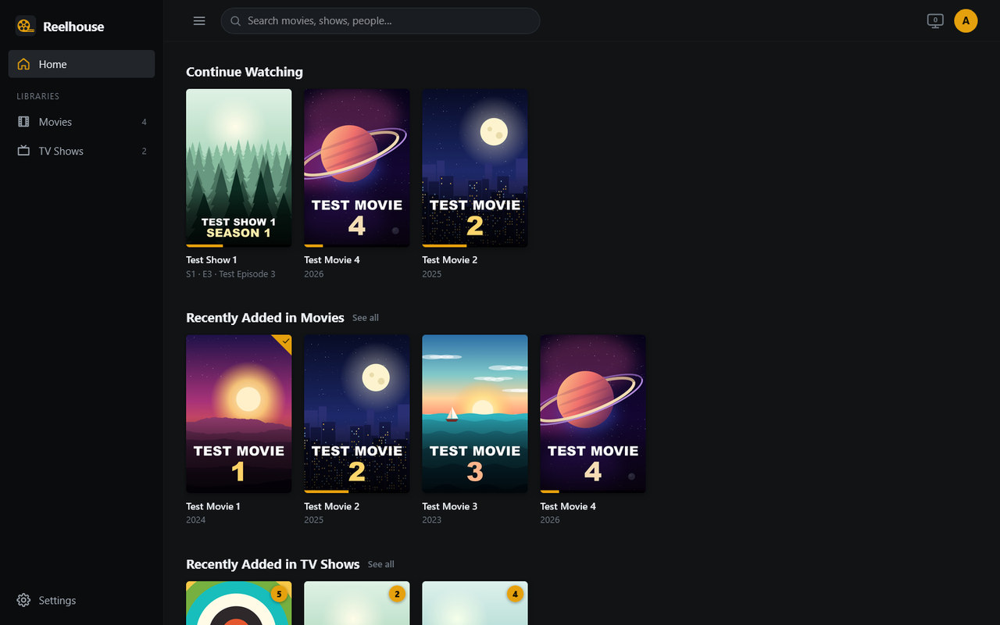
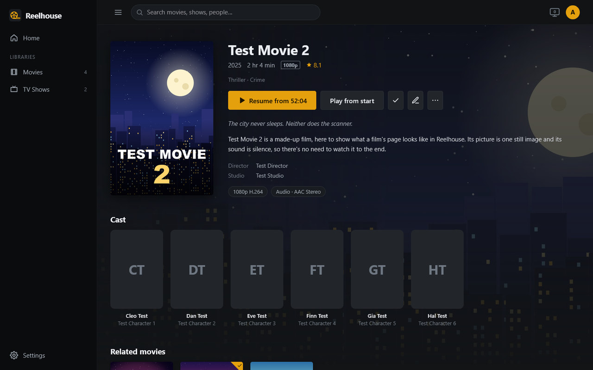
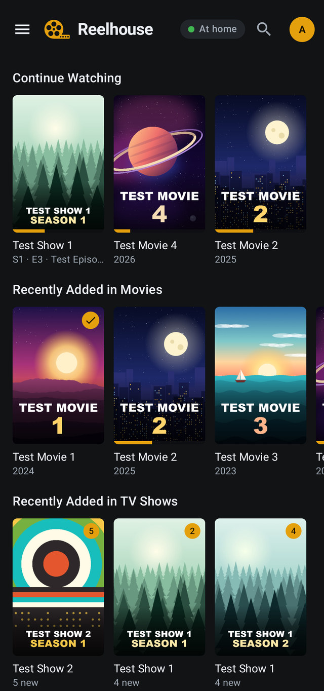

# Reelhouse

A self-hosted media server for your **movies and TV shows**, with a polished web app.
Everything runs on your own computer: no cloud accounts, no subscriptions, no paywalled features.



<p>
  
  
</p>

*The screenshots show made-up test films and shows.*

- Organizes movie and TV folders automatically (posters, descriptions, cast, seasons and episodes), and open pages
  update by themselves when new media arrives; a library can span several drives (a show split across drives is
  one show), and each can have its own icon in the sidebar
- Every movie and show page suggests related titles from your own library, plus more with its leading actors
- Click anyone in a cast for their page: a short biography, what of theirs is on your server, and the movies of
  theirs you don't have (from TMDB)
- Admins can pick each title's poster and background from TMDB's artwork or their own image files
- Streams to any modern browser on your phone, tablet, laptop or TV
- Converts on the fly (with your GPU if you have one) when a device can't play a file as-is
- Multiple users, each with their own watch history, "Continue Watching" and library access, and a "Watched by
  Others" row on Home with what everyone else has been watching (anyone can keep theirs private), and a picture
  of their choosing for their account (checked before it's kept)
- Admins choose how many devices each person can play on at once (2 unless they choose otherwise, or no limit)
- See what's being watched: a count in the top bar for admins, the details in Settings → Activity & logs, and a log
  of who started and stopped what, on which device
- Subtitles (embedded and `.srt`/`.ass`/`.vtt` files), multiple audio tracks, chapters (buttons to skip between them), and audio/subtitle sync
  adjustment in milliseconds (earlier or later)
- Remote access built in: **WireGuard VPN** with QR codes for phones, or **Dynamic DNS + port forwarding + free HTTPS certificates**,
  plus a WireGuard tunnel built into Reelhouse for the Reelhouse app (paired with a QR code, only the app's traffic
  goes through it)
- A **Reelhouse app for Android** that plays at home or away, downloads for offline viewing, and installs and updates
  from your own Reelhouse, on phones, tablets and TV boxes such as a Fire TV (driven with its remote)
- A **Kodi add-on** that puts your movies and shows into Kodi's own library, with watched status and resume points
  kept in sync both ways
- **Live TV** from [Tvheadend](#live-tv-tvheadend): a TV guide, live channels in the browser and the Android app, and
  recordings scheduled from the guide, one at a time or a whole series, for the accounts you allow, each person seeing
  their own on a Manage Recordings page, and, if you like, the channels they've watched in Continue Watching
- **[Requests](#requests)**: anyone can ask for a movie that isn't on the server, and see what everyone has asked for

## Installing

Reelhouse runs on **Windows**, **Linux** (including NAS boxes and Raspberry Pi 4/5) and in **Docker**. It needs
Node.js 22.13+ and ffmpeg 4.4+.
After starting it, open <http://localhost:8484> on the same computer, or `http://<server-ip>:8484` from another
device at home. The first visit creates the admin account (only possible from your home network), then lets you add
your Movies and TV folders.

### Windows

1. Install [Node.js](https://nodejs.org) 22.13 or newer (24 recommended) and ffmpeg: `winget install Gyan.FFmpeg`.
2. Double-click **start.bat** in the project folder. The first time (and after an update that changes them) it
   installs the packages Reelhouse uses, then starts it; the window shows the address to open. It says plainly if
   Node.js is missing or too old, or ffmpeg isn't found. Close the window, or press Ctrl+C, to stop Reelhouse.
   (`npm install` and `npm start` in a terminal do the same.)

Windows Firewall asks whether Node.js may accept connections the first time. Allow it for private networks.

### Linux

```bash
# Debian/Ubuntu: ffmpeg from the distro, Node.js 24 from NodeSource (or use nvm)
sudo apt install ffmpeg
curl -fsSL https://deb.nodesource.com/setup_24.x | sudo -E bash - && sudo apt install nodejs
./start.sh
```

`./start.sh` (from any folder) checks Node.js and ffmpeg, installs the packages Reelhouse uses the first time (and
after an update that changes them), then starts it; Ctrl+C stops it. `npm install` and `npm start` do the same.

To run it as a service, see [deploy/reelhouse.service](deploy/reelhouse.service). It sets up a systemd unit that
runs as its own user and keeps data in `/var/lib/reelhouse`.

### Docker

The ready-made image is on GitHub's container registry, for 64-bit Intel/AMD servers (`x86_64`). Copy
[docker-compose.yml](docker-compose.yml) to your server, edit the media paths in it, delete its `build: .` line and
change its `image:` line to:

```yaml
image: ghcr.io/grimreaper-byte/reelhouse:latest
```

Then start it:

```bash
docker compose up -d
```

To build the image yourself instead (for your own changes, say), keep those two lines as they are and run this in the
project folder:

```bash
docker compose up -d --build
```

- **Folders:** everything Reelhouse writes lives in `/config`: the database, artwork and subtitle caches,
  certificates, WireGuard files, the uploaded Android app and (unless moved) temporary conversion files. That's the
  one folder to keep and back up. Optionally mount a fast disk at `/transcode` and choose it in Settings →
  Transcoder → Temporary folder.
- Mount media read-only (`:ro`) anywhere under `/media` (e.g. `/media/movies`, `/media/tv`, or one mount at
  `/media`) and add those paths as libraries; Reelhouse never writes to your media. Libraries are stored with these
  container paths, so when changing mounts later, change only the host side.
- **Media on several drives** (e.g. `/media/drive1/Movies` and `/media/drive2/Movies`): add both folders to one
  library (Settings → Libraries → edit → **Add folder**) and they show up together. A show whose folder is on more
  than one drive (same folder name) is one show, with the seasons from each. Adding a second library with the same
  name and kind adds its folders to the first, and two that already exist can be merged on the Libraries page
  without losing watch history.
- `PUID`/`PGID` set the user that owns `./config` and can read your media (default 1000:1000).
- GPU transcoding: uncomment the `/dev/dri` device (Intel/AMD, VAAPI) or the NVIDIA section, which needs the
  [NVIDIA Container Toolkit](https://docs.nvidia.com/datacenter/cloud-native/container-toolkit/) on the host.
  The driver always lives on the host. See the **[GPU guide](docs/gpu.md)** for OpenMediaVault, TrueNAS, Proxmox and WSL.
- Keep the container port at 8484 and change the host side of the port mapping if you need another port.
- **Host networking** (`network_mode: host` instead of `ports:`, Linux hosts): the container uses the host's network
  directly. Reelhouse notices, so pairing codes carry the server's home address, the Remote access page shows the
  host's addresses, and nothing needs publishing (HTTPS and the app tunnel's UDP port included). Automatic router
  setup (UPnP) needs it; otherwise forward ports on your router manually. If the guess is ever wrong, set
  `REELHOUSE_HOST_NETWORK` to `1` or `0`.
- Finish the first-run setup before exposing the port to the internet.

**In Portainer:** add a stack with the compose file above, with those two lines changed and your own full host paths,
or use **Containers → Add container**: image `ghcr.io/grimreaper-byte/reelhouse:latest`, network `host` (or publish
port 8484), environment `TZ`, `PUID`, `PGID`, bind volumes `/config` and `/media` (read-only), restart policy *Unless
stopped*, and for a GPU the `/dev/dri` device or the NVIDIA GPU option. To update, **Recreate** the container (or
**Update the stack**) with re-pulling turned on.

**From an image file** (a server without internet access, or your own build): build the image on another machine, save
it to a file, and load that on the server.

```bash
docker save -o reelhouse-image.tar reelhouse:latest
```

Building with `--build-arg REELHOUSE_COMMIT=$(git rev-parse --short HEAD)` (with `docker build` or
`docker compose build`) lets the server say which commit it was built from.

In Portainer: **Images → Import** the file (it arrives as `reelhouse:latest`), then set up the container as above with
image `reelhouse:latest` and **Always pull the image** off. To update, import the new image and **Recreate** the
container (or **Update the stack**) with re-pulling turned off.

**Docker on Windows through WSL 2** (Docker Engine installed inside Ubuntu, without Docker Desktop):
- WSL shuts Ubuntu down a few seconds after the last WSL window or command closes, and that stops Docker and the
  container. Keep an Ubuntu window open while using it, for example one running `docker logs -f reelhouse`.
- `localhost:8484` in Windows reaches the container through WSL's port forwarding, with or without host networking.
  Host networking there means WSL's own network, not your home network, so phones can't reach the container
  directly.
- Windows drives are under `/mnt/c`, `/mnt/d` and so on; mount media from there, e.g. `/mnt/d/Movies:/media/movies:ro`.
- Reading from Windows drives is slower than from the Linux file system, but fine for streaming.

## Organizing your media

Reelhouse understands the usual naming schemes. The most reliable layout is:

```
Movies/
  Heat (1995)/Heat (1995).mkv
  Heat (1995)/Heat (1995).en.srt          ← subtitles next to the video
TV/
  Breaking Bad (2008)/
    Season 01/Breaking Bad - S01E01 - Pilot.mkv
    Specials/Breaking Bad - S00E01 - ....mkv
```

Release-style names (`The.Matrix.1999.1080p.BluRay.x264.mkv`, `show.s02e05.720p.mkv`, `Show 1x05`) work too.
Add `{tmdb-949}` to a folder name to force a specific match. Kodi `.nfo` files and `poster.jpg` / `fanart.jpg` next
to your media are picked up automatically: `movie.nfo` or `<video name>.nfo` for movies, `tvshow.nfo` in a show's
folder and `<video name>.nfo` for episodes (as written by Kodi, tinyMediaManager or Jellyfin). Whatever an `.nfo`
sets (title, plot, cast and so on) wins over the online metadata, and adding, editing or deleting one later is
noticed on the next scan; there's no need to re-add the file. Actor photos are taken from the `.nfo`'s TMDB thumbnail
links, or from TMDB's cast when the names match. Image files are read when a title is first added; one you add later
isn't picked up by scans yet, but you can choose it with the pencil button (see **Changing artwork** below).

Two copies of a film in one library (say `Heat (1995).avi` and `Heat (1995) 1080p.mkv`, in one folder or two) are
one film: they have the same online match, or the same title and year when there's no match. **Play** plays the
best copy (the sharpest picture). The film's page shows a badge for each copy's quality (e.g. 1080p and SD), and
**⋯ → Play version…** plays, resumes or downloads any of them; **Media info** has a tab for each. Watching either
copy counts for the film, and deleting one copy leaves the other, still where you left off. The Android app has
Play version… under **⋮** (since app 0.1.13); Kodi gets the film once and plays the best copy.

In the web app, a library sorted by Title has the letters down the right of the page: click one to jump to that part of
the list (since 0.19.0 whenever the page can scroll, with the letters that have no titles dimmed). Each library remembers
its own sort, so one left on Date added shows no letters until it's sorted by Title again.

The order of your libraries in **Settings → Libraries** (move them with the arrows) is their order in the sidebar,
on Home and in the Android app; it's saved straight away. Each library can also have its own icon (since 0.9.0):
pick one when adding a library or with its edit button — a film strip, a TV, a TV with a red recording dot, an old
TV, a flat-screen TV, a TV with a play button, a clapperboard, a movie camera, a trophy or a heart. A library starts
with its type's (the film strip for movies, the TV for shows), and the sidebar in the web app, the Android app
(0.4.0) and Kodi's Reelhouse screens (add-on 0.3.0) shows the one you picked; older apps keep the type's.

**☰** beside the search box shrinks the sidebar to its icons (point at them and the full sidebar slides out); click
it again for the full sidebar. The browser remembers which you chose.

New files appear within about a minute (folders are watched), and there's a full rescan every hour. Open pages update
by themselves when that happens: the new title shows up in the library and on Home, the sidebar counts change, and a
short "1 new movie in Movies" notice pops up. No need to reload. Posters fill in the same way once they've been
downloaded. While new files are being read, the top bar says which one, just after the search box, e.g. "Adding 4 of
12: Heat (1995).mkv", with a bar under it (since 0.20.0; on a phone, just the count and the bar); scans that find
nothing new don't show it.

Folder watching relies on the operating system's change notifications. On network shares (SMB/NFS) mounted from
another machine these often don't arrive, so new files there show up at the next hourly scan, or right away if you
press **Scan library files** in the library's ⋯ menu.

## Posters and descriptions (free TMDB key)

Metadata comes from [The Movie Database](https://www.themoviedb.org). Create a free account, request an API key
under *Settings → API*, and paste it into **Settings → Metadata**. Without a key, titles come from file names and
artwork from local files or frames of the video.

If something is matched wrong, open it and choose **⋯ → Fix match**. To use a different poster or background, use
the pencil button on the same page (admins only; see **Changing artwork** below).

## Remote access

Open **Settings → Remote access**. First make your home reachable, then pick a way in: the Reelhouse app tunnel,
WireGuard, or a web address (one, or more than one).

### Make your home reachable (needed by every way in)

1. **Dynamic DNS**: home connections usually get a new public IP now and then. Devices are given your home's address
   when you add them, so it should be a name that follows the IP:
   - Let Reelhouse keep a name updated: get a free one at [Duck DNS](https://www.duckdns.org) (or use Cloudflare,
     No-IP, Namecheap or any DynDNS2 provider) and enter it.
   - If your router (or another program) already updates a name, choose **Updated elsewhere** and enter the name.
     Reelhouse checks that it points at your home and uses it everywhere.
   - With a fixed (static) IP, choose **None**. Devices are then given the IP itself.

   Without a name, devices get the public IP of the day they were added, and the page warns about it. When it changes,
   WireGuard devices need adding again (or their address edited); paired apps pick up the new address once they're
   back on your home network. WireGuard devices added before you set up a name keep the address they were given.
2. **Port forwarding**: forward the ports of the ways in you use to this computer, or turn on UPnP. The page lists
   them. The web port is only needed for a web address (Option 3), so UPnP leaves it closed unless you tick
   **Also open the web port**. With only the app tunnel or WireGuard, Reelhouse stays hidden from the internet.

### Option 1: The Reelhouse app tunnel (if you only use Android devices away from home)

The simplest way in when the only devices you use away from home are Android phones and tablets with the Reelhouse
app. **You don't need to install WireGuard**, on the server or on the phone: the tunnel is built into Reelhouse and
into the app. It uses the same encryption as WireGuard, but there's no WireGuard program to install or set up.
Nothing else on the phone goes through it, other VPNs keep working, devices are added without restarting anything,
and only Reelhouse can be reached through it (not the rest of the machine).

1. In **Settings → Remote access → Reelhouse app tunnel**, tick **Use the app tunnel** and save.
2. Forward **UDP 51821** to this computer on your router, or turn on UPnP. With Docker, also publish the port
   (`- "51821:51821/udp"`), unless the container uses host networking.
3. Pair each phone from **Your account → Apps and devices → Pair the Reelhouse app**: scan the QR code in the app,
   or type the code while at home. Each phone gets its own key; signing the phone out removes it. An admin can
   also make the code for someone else, without their password: **Settings → Users**, the link button next to them.

The Docker image includes the tunnel; on a Windows or Linux install, build it first
([tunnel/README.md](tunnel/README.md)). The app itself is in [android/](android/README.md). It pairs, browses,
searches, updates live, plays (directly or converted, with resume and the next episode) and downloads for offline
viewing. Phones install it from Reelhouse itself: download the APK from the [latest
release](https://github.com/grimreaper-byte/reelhouse/releases/latest) (or build it yourself), upload it in **Settings
→ Android app**, then open `http://<server>/android/` on the phone (the pairing dialog has a QR code for it).
Uploading a newer version lets every phone update itself from Settings in the app. It also runs on a Fire TV or
Android TV box, from Android 7.1, with its remote (since app 0.13.0;
[how to install it](android/README.md#on-a-fire-tv-or-android-tv-box)).

For a web browser, a laptop, an iPhone or Kodi away from home, use Option 2 as well.

### Option 2: WireGuard VPN (recommended)

The way in for any device, not just the Reelhouse app: web browsers on laptops, iPhones and iPads, Kodi. This one
does need WireGuard installed, on the server and on each device. Your devices join an encrypted tunnel to your
computer. Reelhouse stays invisible to the internet, and only WireGuard's UDP port is open. WireGuard ignores anyone
without a key.

1. Install [WireGuard](https://www.wireguard.com/install/) on the media server computer. With Docker, install it on
   the Docker host, not in the container.
2. In Reelhouse, click **Generate server keys**. Then activate the tunnel:
   - **Windows:** click **Install tunnel on this PC** (Windows asks for admin permission), or import
     `reelhouse.conf` in the WireGuard app.
   - **Linux:** copy the generated `reelhouse.conf` to `/etc/wireguard/` and run
     `sudo systemctl enable --now wg-quick@reelhouse`.
   - **Docker:** do the same on the host. The file is in `config/wireguard/`.
3. On your router, forward **UDP 51820** to this computer, or turn on UPnP (step 2 above).
4. Click **Add device** for each phone or laptop. On a phone, scan the QR code with the WireGuard app. On a
   computer, import the downloaded `.conf`.
5. Re-install (Windows) or re-copy and restart (Linux) the tunnel after adding or removing devices.
6. With the tunnel on, open `http://10.77.0.1:8484` on the device.

### Option 3: Direct access with a web address (not recommended)

This puts Reelhouse's sign-in page on the internet, where anyone can find it, so use it only if Options 1 and 2
don't suit you. Needs a dynamic DNS name and the web port forwarded (both above: with UPnP, tick **Also open the
web port**). Then turn on **HTTPS**: choose *Let's Encrypt*, accept the subscriber agreement and click **Get
certificate**. With Duck DNS or Cloudflare no extra ports are needed (DNS verification). Otherwise port 80 must be
forwarded too. On Linux (non-root) or in Docker, set `REELHOUSE_ACME_PORT=8080` and forward router port 80 to it.
Certificates renew automatically.

Your server is then at `https://yourname.duckdns.org:8443`. Use strong passwords: the sign-in page is on the internet.
Logins are rate-limited.

**CGNAT**: some internet providers don't give you a public IP. Reelhouse warns you when it detects this. None of
the ways in work then. Ask your ISP for a public IPv4 address, or use a relay such as Tailscale or Cloudflare Tunnel.

**Windows Firewall**: connections arriving through WireGuard or from the internet may land on the *Public* firewall
profile. Use **Allow through Windows Firewall** on the Remote access page, or run this in an admin PowerShell:

```powershell
New-NetFirewallRule -DisplayName 'Reelhouse Media Server' -Direction Inbound -Action Allow -Protocol TCP -LocalPort 8484,8443 -Profile Any
```

## Playback and transcoding

Files the browser can play (for example MP4/H.264/AAC) are streamed as-is ("Direct Play"). Everything else is
converted to HLS on the fly. Seeking anywhere works, and conversion pauses when the player is far enough ahead.
GPU encoders are detected automatically and can be picked in **Settings → Transcoder**: NVIDIA NVENC, Intel Quick
Sync, AMD AMF on Windows, and VAAPI on Linux. If a GPU encoder fails mid-stream, that stream switches to the CPU.
Some VAAPI drivers (often Intel without its HuC firmware) can't limit the bitrate: Reelhouse notices and converts
at a constant quality per setting instead, still on the GPU.
The **Hardware acceleration** panel lists your processor (including whether it has integrated graphics), the GPUs it
can see, and what to fix when one isn't working. Setup guides are in [docs/gpu.md](docs/gpu.md).
HDR video is tone-mapped to SDR and interlaced video is deinterlaced when converted.

When only the sound (or the file type) needs converting, the picture is copied as it is and just the sound is
converted: for example a 4K MKV with Dolby Digital Plus (EAC3) sound in Firefox, which can show the picture but not
play that sound. That costs next to nothing, where converting a 4K picture can be slower than real time. It works
for MKV files in the web player; the log and **Activity** say "the picture copied as it is". If the browser
can't show the copied picture, the player switches to converting it within a few seconds. Choosing a lower quality
converts the picture as before. MKV files keep their frame times to the millisecond (a 23.976 fps film's frames come
41 or 42 ms apart instead of 41.7), which browsers would show as a slight judder; Reelhouse puts the copied frames
back on their even times as it hands each piece out. Each time copying resumes (it pauses when it's well ahead of
the player), it starts one piece early so that frames shown before a keyframe keep their place; many films (x265's
"open GOP") have them, and starting at the keyframe itself would bunch them into a hitch. Firefox plays MKV files
itself but shows each frame at its stamped time, so it judders (and drops frames) on those millisecond times: it gets
such files copied this way even when it could play them directly, whenever the frame rate doesn't fall on whole
milliseconds (23.976, 24, 29.97, 30 or 60 fps; 25 and 50 fps play directly). The sound then comes as stereo AAC. A file
without a keyframe index still plays directly. Chromium browsers play MKVs directly as before. In about one film in
twenty the picture starts a little after the sound (by up to half a second); a copied stream then starts with the
picture (the moment of sound before it is left out), so that every piece lines up, and the player still shows film
time and keeps subtitles in step.

Converting 4K is heavy: the GPU only encodes, so the original is decoded (and HDR tone-mapped) by the processor. A
4K 10-bit HEVC film may not convert to a lower quality smoothly on a small server, such as one with a 2-core laptop
processor; play it at **Original**, which copies the picture and plays smoothly.

If a browser accepts a file but then can't show it (sound with a black picture, or an error), the player switches
to converting by itself within a few seconds. One known case is handled up front: MKV files made around 2009–2012
often use "header compression", which Firefox can't read, so Firefox gets those converted while Chrome and Edge play
them directly.

In the player, the gear menu has Quality (useful away from home; it lists only the original and the qualities
below it) and Speed. Away from home, playing starts at **Settings → Server → Conversion → Default quality outside
your home network**: Original unless you change it (since 0.22.0), so nothing is converted that a device can play
as it is. If your upload can't keep up with your files, pick something lower there. The **Audio & subtitles** button
lists every audio track and subtitle. Image-based subtitles (PGS/VobSub) are burned into the picture.

**What's being watched:** admins see a TV in the top bar (next to the account button) with the number of streams
playing right now on its screen, from browsers, the Android app and Kodi alike. It updates by itself, and clicking it
opens **Settings → Activity & logs**, which lists each stream: who, on which device, played directly or converted (and
why), and how far in. The log records every stream that starts and stops, with the user and device, e.g. `User "admin"
started "My Movie" on Pixel 8 (192.168.0.20) (direct play)` and `User "admin" stopped "My Movie" … at 3:50 of 7:57`. A
player that goes quiet (a closed tab, a lost connection) counts as stopped after 2 minutes, or 15 while paused.

**Out of sync?** The same panel has **Sync** controls for the audio and the subtitles. Use the −/+ buttons (50 ms
steps) or type any number of milliseconds: positive values play it **later**, negative values **earlier**.
Reelhouse remembers the offset for that title and track. Subtitle timing changes instantly. Audio delay makes the
server convert the video while it's set, so the stream restarts once you stop adjusting; Reset returns to Direct
Play.

The control bar shows what's playing and the time on the left, the playback buttons in the middle (previous episode,
previous chapter, back 10 s, play/pause, forward 30 s, next chapter, next episode, stop) and the other tools on the
right. On phones it becomes two rows. The ■ stop button goes back to the title's page; your position is saved, so
**Resume** carries on from there.

Films with chapters in the file (common in MKVs) show their chapters as marks on the seek bar, and two chapter buttons
(since 0.10.0): « goes back to the start of the chapter playing, or to the one before if it began under 3 seconds
ago, and » goes to the next. Each jump names the chapter for a moment ("Chapter 3 of 12 · The Heist"; the name only
when the file gives one), and pointing at the seek bar shows the chapter there. A keyboard's or headset's
next/previous keys go between chapters too, unless there's a next or previous episode. In the Android app (since
0.5.0) the player's ⏮ and ⏭ do the same for films with chapters. Kodi's own player shows a file's chapters itself.
Volume is a vertical slider above the speaker button: hover it with a mouse (click to mute), or tap it on a touch
screen. iPhones and iPads only allow volume from the side buttons, so there the speaker button just mutes.

Keyboard: `Space`/`K` play/pause · `X` stop · `←`/`→` 10s/30s · `↑`/`↓` volume · `F` fullscreen · `M` mute ·
`C` subtitles · `G`/`H` subtitles 50 ms earlier/later · `P`/`N` previous/next episode · `Page Up`/`Page Down`
previous/next chapter · `Esc` back.

Season pages can show episodes as a detailed list or as a grid of episode stills; use the toggle next to the season
tabs.

**Changing artwork (admins):** the pencil button on a movie, show, season or episode page opens the artwork editor.
Pick the poster or background (a season's poster, an episode's thumbnail) from every image TMDB has for it, or from
image files in the title's own folder. Your pick stays when metadata is refreshed; choose **Automatic** to let
Reelhouse decide again. TMDB's images need a TMDB key (Settings → Metadata) and a matched title.

**Downloads:** every signed-in user can save the original file with **⋯ → Download file** on a movie or episode, for
the libraries they have access to, and the Android app can download movies, episodes and seasons to watch offline.
It's one server-wide switch, **Allow downloads** in Settings → General: off on a new server (since 0.19.0; one already
in use keeps what it had). Turning it off hides the option and blocks downloads for everyone straight away, including
ones in progress. Files already downloaded to a phone still play.

## Live TV (Tvheadend)

Reelhouse can show [Tvheadend](https://tvheadend.org)'s TV guide, play its channels and schedule its recordings.
Tvheadend does the TV side (tuners such as an HDHomeRun, the guide, recording); Reelhouse is where you watch.

1. In Tvheadend, give Reelhouse an account: **Configuration → Users → Access Entries**, tick **Web interface**, set
   **Streaming** to Basic and, if Reelhouse should schedule recordings, **Video recorder** to Basic; set its password
   under **Passwords**. (Tvheadend's Digest and Plain sign-in both work.)
2. In Reelhouse, **Settings → Live TV**: turn it on, enter Tvheadend's address (e.g. `http://192.168.1.50:9981`) and
   that account, and press **Test connection**. It shows Tvheadend's version, how many channels it found, whether
   the account may watch and record, and (if it may record) how much space is left on Tvheadend's recordings drive.
   Pick the recording profile to use, and save.
3. **Settings → Users**: each account has **Can watch live TV** (on for new accounts), **Can schedule recordings**
   (off until you turn it on) and **Can set series recordings** (since 0.20.0; off until you turn it on, and it needs
   Can schedule recordings). Admins can always do all three.

**Live TV** then appears in the sidebar. The guide is a grid of channels and times (a now/next list on a phone),
tinted by genre in Kodi's colours (film orange, news green, sport red, children's teal…) when Tvheadend knows the
programmes' genres, as broadcast guides do, with the time now at the top right. The programme under the mouse is
described under the grid (with the minutes left, or its length); the arrow keys move around it as a remote does in
Kodi (←/→ along a channel, ↑/↓ between channels, Enter to open). A programme opens its details with **Watch** and
**Record**, **Cancel recording** or **Stop recording**, and **Record series** for the accounts allowed to. In the
player, the arrows (or Page Up / Page Down) change channel, pausing keeps up to five minutes, **Live** jumps back to
now, and the gear picks a lower quality for slow connections (only those below the channel's own picture are offered).
Channel logos come from Tvheadend (whatever it shows in its own channel list) and are kept by Reelhouse, so they
appear straight away; the playing channel's logo sits in the corner of the control bar. SVG logos are drawn as PNGs,
so the Android app and Kodi can show them too; that needs an ffmpeg with SVG support (librsvg), as the Docker image's
has. Without it they stay SVG, which browsers show but the app and Kodi replace with the channel's first letters.

**Radio** has its own page in the sidebar: the same guide for radio stations. Listening shows the station's
logo and programme instead of a picture, and the arrows change between radio stations. Reelhouse knows a station is
radio from Tvheadend's channel tags (its "Radio channels" tag, made when it maps services with *Create type-based
tags*; any tag with "radio" in its name works); Settings → Live TV's test says how many it found.

**Channels in Continue Watching** (since 0.21.0; off until you turn it on in Settings → Live TV): a channel someone
has watched for at least 30 seconds appears on their Home among the films and episodes they're part-way through, the
most recent first. It's just the logo and name, with nothing about what's on and no timeline, and selecting it plays
it. Each person has their own, the newest 8 show, and radio stations don't appear. This works in the web app, the
Android app (since 0.12.0) and the Kodi screens.

The **Android app** has Live TV and Radio in its sidebar too, for the same accounts: a now/next list with the phone
upright, the grid on its side or on a tablet, the same programme details with **Watch** and recording, and a player
with channel up/down, pause and **Live**, and the quality. Leaving the app stops the stream (freeing the tuner) and
coming back starts it again; nothing keeps playing in the background.

**Series recording** (since 0.20.0, app 0.11.0, Kodi add-on 0.11.0; Tvheadend calls these autorecs): **Record series**
in a programme's details records every episode of that show on that channel from then on, as the guide lists them. It
goes by the guide's series link when there is one, else by the show's whole name, with or without "New: " in front, so
"News" doesn't catch "Newsnight". Repeats are left out when the guide can tell, by its programme ids, else its series
and episode numbers, else the subtitle and description; when it can't, they record too (a "New: " episode and a later
repeat without it only count as the same when the guide's programme ids match). A scheduled episode then offers **Skip
this episode** rather than Cancel recording, as Tvheadend would schedule a cancelled one again, and **Record** puts a
skipped one back. **Cancel series recording**, in a programme's details or under **Series recordings** on Manage
Recordings, removes what it has scheduled; what's recording now or already recorded stays. A show has one series
recording on a channel: if someone else has it you're told whose, and only they or an admin can change it. Turning
someone's switch off stops them setting new ones; those they have carry on until they or an admin cancel them, and
deleting someone's account ends theirs. A new series can come with a series link of its own, which the old one won't
catch: **Record series** on one of its programmes sets another.

**Manage Recordings** (since 0.14.0, called Recordings before 0.18.0; in the Android app since 0.6.0, and in Kodi's
Reelhouse screens since add-on 0.6.0) is in the sidebar for the accounts that may record. It looks like a TV library
(since 0.17.0, app 0.8.0, Kodi add-on 0.8.0): what you've set to record from the guide, grouped by show, each with its
cover art — a poster from TMDB found by the show's name (with a TMDB key, as for posters; only a show or film with
exactly that name that people have voted on, so a generic name like "News" gets none rather than a wrong one), else
the guide's own picture, else the channel's logo. The shows sit under headings (since 0.18.0, app 0.9.0, Kodi add-on
0.9.0), each a grid like a library's (since 0.19.0, app 0.10.0, Kodi add-on 0.10.0): **Recording now** (a red REC
mark), **Recorded** (newest first, the number of recorded episodes in the corner) and **Scheduled** (soonest first,
with when the next episode records); a show with episodes in more than one is in each. Under them are your **Series
recordings** (since 0.20.0, app 0.11.0, Kodi add-on 0.11.0), each with when its next episode records. Across from the
title is how full Tvheadend's recordings drive is, as in Settings → Live TV (since 0.20.0; in the app, on the line
under the title). A "New: " in front of a programme's name (how UK guides mark a new episode) is left off here, so new
episodes and repeats are one show. A show opens its series' covers (TMDB's poster for each series, else the show's;
the guide's series numbers), and a series its episodes' pictures (TMDB's still for each episode, else the guide's
picture), each with its day, time, length and size, and Scheduled, REC or Tvheadend's word when something went wrong
("Time missed"); a show without series numbers opens straight to its episodes. Pointing at a cover (always, on a
phone) shows a button in its top left corner: the bin deletes the show (under Recorded), the series or the recording
(deletes its file from Tvheadend's recordings drive, after asking; what's still to come keeps recording), × cancels a
scheduled episode (skips it, if a series recording set it) or a series recording, and ■ stops one recording now
(what's recorded stays). **Delete show** and **Delete series** at the top of their pages do the same; an episode opens
its details, with who set it and their picture. The pages keep themselves up to date. People see only their own; in
the guide, a recording someone else set shows as recorded but only they or an admin can cancel it. Admins can switch
to **Everyone's** and change any: under each cover is who set it, their picture and name as under a request's poster
(since 0.19.0, app 0.10.0, Kodi add-on 0.10.0). Tvheadend records everything under the one account Reelhouse uses, so
Reelhouse keeps who set what itself: recordings scheduled before 0.14.0, or in Tvheadend or Kodi's own TV section,
show only in Everyone's, as not set through Reelhouse (and only those Tvheadend lets Reelhouse's account see: its own,
or all of them if it has Tvheadend's right to manage every recording).

If the guide, the channels or their logos look wrong or out of date, **Settings → Live TV → Delete cached guide data
and fetch again** throws away what Reelhouse kept from Tvheadend and fetches it all again, then says what came back
(nothing is deleted if Tvheadend doesn't answer). If the guide is wrong in Tvheadend too, have Tvheadend fetch it
first: **Configuration → Channel / EPG → EPG Grabber**, *Re-run Internal EPG Grabbers* or *Trigger OTA EPG Grabber*.

Broadcast TV is interlaced and its sound often MP2 or AC3, so Reelhouse converts every channel (with your GPU if you
have one). Each channel being watched holds one of Tvheadend's tuners until its player closes, and counts towards the
account's devices playing at once. To watch recordings, add Tvheadend's recordings folder as a library (**Settings →
Libraries**); its `.ts` files play like any other. A "New_ " or "New: " in front of a show's folder or file names (how
Tvheadend writes the UK guide's "New: " for a new episode) is left off there too (since 0.18.1), so new episodes and
repeats are one show with its TMDB poster, with a folder per show or the recordings all in one folder; a library
scanned before puts them together on its next scan, keeping what was watched. In Docker, Reelhouse only needs to reach
Tvheadend's web port (9981).

## Requests

**Requests** in the sidebar (web app and Android app) is where anyone can ask for a movie that isn't on the server.
Search for it (a year after the title narrows it down, e.g. "Heat 1995"): each film found on TMDB either opens
(it's already on the server), says who has already asked for it, or has a **Request** button. Below the search is
every request, newest first, with its poster, who asked and when; the sidebar shows how many there are.

You can remove your own requests; admins can remove anyone's, or all of them at once. A request also goes by itself
once its movie is in a library the person who asked can open (checked after each library scan, matched by its TMDB
entry). Requests needs a TMDB key (see [Posters and descriptions](#posters-and-descriptions-free-tmdb-key)): it stays
off until one is set up, as on a fresh install, with its box in Settings → General unticked and greyed out, and turns
on by itself once one is added (since 0.11.0).

Admins can turn Requests on or off in **Settings → General** (since 0.10.0; on once there's a key). Turned off, it's
gone from everyone's sidebar, an open Requests page says so, and nothing can be asked for or removed; the list is
kept, and comes back when it's turned on again. The Android app hides it the next time it's opened.

The same panel can limit how many requests each person has waiting at once (since 0.11.0; 0 for no limit, which is
where it starts). Admins aren't limited, and a request stops counting once its film arrives or it's removed. Someone
at their limit sees how many they have on the Requests page, with the Request buttons greyed out; the Android app
says why if they try.

## Kodi

The Reelhouse add-on for Kodi 21 puts your movies and TV shows into Kodi's own Movies and TV Shows sections, with
artwork, cast and file details, and plays them straight from Reelhouse. Watched marks and resume points stay in sync
with the web app both ways, and new media appears in Kodi within seconds of Reelhouse finding it. Its **Open
Reelhouse** (since add-on 0.2.0) shows Reelhouse as the web app looks — sidebar, Home, libraries, film and show pages,
search, the live TV guide and Manage Recordings — driven with the remote, and it can open by itself when Kodi starts.
Back never leaves it (since add-on 0.4.0): the sidebar's **Exit** returns to Kodi, and while something plays **Now
playing** at the top of the sidebar returns to the player (since add-on 0.11.0). While a live channel plays, Kodi's
controls show the channel's logo and how long the programme has left (since add-on 0.13.2). When Kodi starts, a
notification says who it's signed in as (since add-on 0.5.0).

Reelhouse serves the add-on at `http://<your server>:8484/kodi/`. In Kodi, turn on **Settings → System → Add-ons →
Unknown sources**, add that address under **Settings → File manager → Add source**, then use **Add-ons → Install
from zip file** and sign in from the add-on. Signed-in Kodi devices are listed under **Settings → Your account →
Apps and devices**, where you can sign them out. Full guide: [kodi/README.md](kodi/README.md).

Admins find all of this in **Settings → Kodi add-on**: what it does, the install steps with this server's address
filled in, the signed-in Kodis, and the things to watch out for. Start with an empty Kodi library (a fresh install
or a new profile): the add-on writes your titles into it, so ones Kodi already has from its own sources would show
up twice. For the same reason, don't add your media folders to Kodi yourself.

## Updating

- **Docker, with the ready-made image:** `docker compose pull`, then `docker compose up -d`. The container is
  recreated from the new image; `./config` is kept. In Portainer, recreate the container with re-pulling turned on.
- **Docker, building it yourself:** replace the project files with the new version (or `git pull`), then
  `docker compose up -d --build`. With an image file instead (Portainer): import the new file, then recreate the
  container without re-pulling.
- **Android app:** upload the newer APK from the [latest
  release](https://github.com/grimreaper-byte/reelhouse/releases/latest) in Settings → Android app; phones offer the
  update in Settings → About (a dot appears on your picture at the top of Home, and on Settings in the sidebar).
- **Windows / Linux:** replace the project files with the new version (or `git pull`), run `npm install`, then restart
  Reelhouse (or `sudo systemctl restart reelhouse`).
- **Kodi:** the add-on doesn't update itself. When `/kodi/` offers a newer zip, install it the same way as the first
  time (Add-ons → Install from zip file); its settings and sign-in are kept.

Settings → Activity shows the version that's running (and the commit it was built from, when known); so does the
first line of the log.

The database is upgraded automatically on the first start of a new version, so libraries, users, watch history and
your artwork choices carry over. Back up the data folder first if you want to be able to go back to an older version.

## Running at startup

- **Docker:** `restart: unless-stopped` in the compose file handles it.
- **Linux:** use the systemd unit in [deploy/reelhouse.service](deploy/reelhouse.service).
- **Windows:** run this in PowerShell from the project folder to start Reelhouse when you sign in:

  ```powershell
  $dir = (Get-Location).Path
  $action = New-ScheduledTaskAction -Execute (Get-Command node).Source -Argument '--disable-warning=ExperimentalWarning server\index.js' -WorkingDirectory $dir
  Register-ScheduledTask -TaskName 'Reelhouse' -Action $action -Trigger (New-ScheduledTaskTrigger -AtLogOn) -Settings (New-ScheduledTaskSettingsSet -ExecutionTimeLimit 0)
  ```

## Configuration

Most settings live in the web UI. A few environment variables are also read:

| Variable | Default | Purpose |
| --- | --- | --- |
| `PORT` | 8484 (or the saved setting) | Override the HTTP port for this run |
| `REELHOUSE_DATA` | `./data` (`/config` in Docker) | Where the database, caches, certificates and WireGuard files are kept |
| `REELHOUSE_SERVER_NAME` | the computer's name | Name shown on the sign-in page (handy in Docker) |
| `REELHOUSE_ACME_PORT` | 80 | Port for Let's Encrypt's HTTP check when port 80 isn't available |
| `REELHOUSE_DEBUG` | unset | Verbose logging, including ffmpeg command lines |
| `PUID` / `PGID` | 1000 | Docker only: user/group the server runs as |
| `REELHOUSE_HOST_NETWORK` | detected | Docker only: `1` or `0` says whether the container uses the host's network |

Back up the data folder to keep users, watch history and settings. Your media files are never modified.

If a library folder is temporarily missing or suddenly empty (an unplugged drive, an unmounted network share),
Reelhouse keeps its items instead of deleting them, and logs a warning.

## Development

```bash
npm run dev     # restarts the server when files in server/ change
npm test
npm run icons   # regenerates favicon.ico and the PNG app icons after editing web/favicon.svg
```

- `server/`: Express API, SQLite (`node:sqlite`), library scanner, TMDB client, HLS transcoder, remote-access helpers
- `web/`: the browser app, written in plain ES modules with no build step. The logo is `web/favicon.svg`; after
  editing it, run `npm run icons` to regenerate the `.ico` and PNG icons
- `kodi/`: the Kodi add-on (Python) and its tests (`python3 -m unittest discover -s kodi/tests`)
- `tunnel/`: the app tunnel endpoint and the `tunnel-check` client (Go; see [tunnel/README.md](tunnel/README.md))
- `scripts/`: developer tools (the icon generator)
- `docker/`, `deploy/`: container entrypoint and the Linux systemd unit
- `docs/`: guides (GPU / hardware transcoding)
- `test/`: unit and integration tests (`npm test`)

## Licence

Reelhouse is released under the [MIT License](LICENSE); the Kodi add-on carries a copy as `LICENSE.txt`. The libraries
it uses keep their own (permissive) licences: the Android app lists them, with their licence texts, in **Settings →
About → Open-source licences**. The Docker image's FFmpeg is Debian's package, under the GPL: its source is at
[sources.debian.org](https://sources.debian.org/src/ffmpeg/), as is that of the image's other Debian packages
(`ffmpeg -version` in the container says which version it has). Posters, descriptions and cast come from TMDB: this
product uses the TMDB API but is not endorsed or certified by TMDB.
